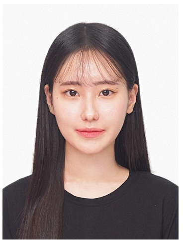
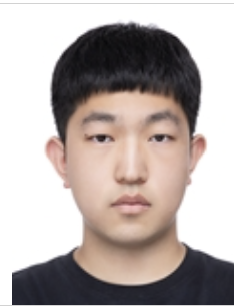

<h1>👥 Team</h1>

<!-- 첫 번째 줄: 4명 -->
<table align="center">
  <tr>
    <!-- 수환 -->
    <td align="center">
      <a href="https://github.com/SooHwanIT">
         
        <b>수환</b>
      </a> 
      Team Leader
    </td>

    <!-- 장예지 -->
    <td align="center">
      <a href="https://github.com/marie11">
         
        <b>장예지</b>
      </a> 
      Team Leader
    </td>

    <!-- 이주원 -->
    <td align="center">
      <a href="https://github.com/tukjoowon">
         
        <b>이주원</b>
      </a> 
      Team Member
    </td>

    <!-- 이완 -->
    <td align="center">
      <a href="https://github.com/ewan6337">
         
        <b>이완</b>
      </a> 
      Team Member
    </td>
  </tr>
</table>

 

<!-- 두 번째 줄: 3명 -->
<table align="center">
  <tr>
    <!-- 전승민 -->
    <td align="center">
      <a href="https://github.com/zkfmxkszkfmxkszkfmxks-cmd">
         
        <b>전승민</b>
      </a> 
      Team Member
    </td>

    <!-- 최아현 -->
    <td align="center">
      <a href="https://github.com/strawberryroll">
         
        <b>최아현</b>
      </a> 
      Team Member
    </td>

    <!-- 최정현 -->
    <td align="center">
      <a href="https://github.com/kuku2785">
         
        <b>최정현</b>
      </a> 
      Team Member
    </td>
  </tr>
</table>
